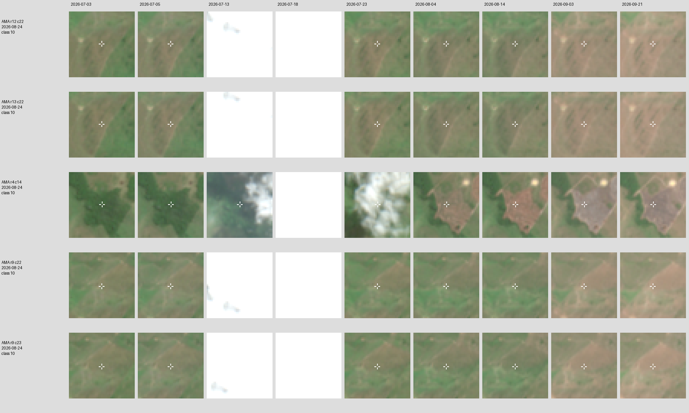

# Положительный контроль: работоспособность детектора пока не доказана

Проверка 14 ноября 2026 года. Цель — найти независимые подтверждённые
изменения, а не только разбирать уже найденные детектором кандидаты.

**Результат:** среди пяти точных пересечений радарной сетки с подтверждёнными
GLAD-пикселями детектор не выдал ни одного HV drop. В одной точке по RGB
видна настоящая расчистка леса. Однако она произошла слишком рано для текущего
радарного ряда: гарантированной истории «до» нет. Четыре другие точки
не удалось однозначно подтвердить как потерю кроны именно в координате
радарного образца. **Это не доказательство работоспособности и не recall 0%.**

## Независимый от детектора отбор

Использован [тот же проверенный выпуск GLAD-L от 13 ноября](amazon-validation.md):
78 подтверждённых пикселей с кодом 3 в сохранённом окне около участка.
Из них 36 датированы вне интервала текущего радара, 18 июля — 28 сентября.
У 37 остальных пикселей нет точного пересечения с точкой разреженной сетки
32×32. Это недостаток пространственного покрытия теста, не пропуск детектора.
Остаются пять радарных точек внутри пяти GLAD-пикселей, все с датой 24 августа.
Отбор не использует `style`, z-score или успешность детектора. Точки и соседние
GLAD-пиксели не считаются пятью независимыми событиями.

Дополнительный свежий запрос DETER за июль — 14 ноября в прямоугольнике
примерно с 5-км запасом вокруг демо вернул **0 полигонов**. Запрос, полный
ответ и SHA-256 сохранены. Отсутствие DETER не опровергает небольшую вырубку.

Для уточнения времени добавлены RGB и SCL за 5, 13, 18 и 23 июля. Вместе
с прежними сценами просмотрено девять дат. Новые изображения сохранены отдельно
от рабочих индексов сайта. Шкала RGB, проверка BOA offset и географические
границы те же, что в [подготовке оптики](optical.md).

## Что видно по точкам и что выдал детектор

| Точка | RGB | Сдвиг среднего HV z | HV drop при пороге −2.5 |
|---|---|---:|---|
| AMA r4 c14 | Лес 5 июля → расчистка не позднее 4 августа | −0.193 | Нет |
| AMA r9 c22 | Низкое/открытое покрытие с начала июля; потеря кроны в точке неоднозначна | −0.494 | Нет |
| AMA r9 c23 | Неоднородный покров и побурение; точечная потеря кроны не установлена | −0.720 | Нет |
| AMA r12 c22 | Уже открытый пятнистый участок; цвет меняется | +0.330 | Нет |
| AMA r13 c22 | Уже открытый неоднородный покров; к сентябрю буреет | −0.126 | Нет |

Это результаты неизменённого `pipeline/classify.py`: k=2.5, минимум два
наблюдения с каждой стороны, те же шесть дат и те же соседские статистики.
Хеш классификатора сохранён в результатах. Пороги не подбирались по тесту.



30-метровый подтверждённый GLAD-пиксель не гарантирует потери леса в каждом
10-метровом образце NISAR. Открытый вид четырёх точек не объявляет GLAD
ошибочным: могут различаться пространственная поддержка, смешанное покрытие
и видимость отдельных крон. Эти четыре случая исключены из положительного
визуального эталона, а не записаны в успешные или неуспешные обнаружения.

## Настоящая расчистка AMA r4 c14 и ловушка даты GLAD

| Наблюдение | Что установлено |
|---|---|
| RGB 3 и 5 июля | В точке и вокруг неё сплошной тёмно-зелёный участок кроны |
| RGB/SCL 13 июля | Тень, SCL=3; для датировки события не используется |
| RGB/SCL 18 июля | Облако, SCL=8; для датировки не используется |
| RGB/SCL 23 июля | В точке SCL=5, но около 24.5% соседнего окна — облака/тени; дата не принята как надёжная граница |
| RGB 4 августа и позднее | Явная расчистка, включающая точку, затем сохраняется |
| GLAD 24 августа | Подтверждённый алерт; это минимум на 20 дней позже уже видимой расчистки |

Время события ограничено интервалом **после 5 июля, не позднее 4 августа**.
Радарные даты — 18 июля, 11 и 23 августа, 4, 16 и 28 сентября.
До последнего уверенного RGB с лесом нет ни одной радарной даты.
Даже при самом позднем событии в интервале у радара могло быть максимум
одно наблюдение «до» — 18 июля. Пять остальных наблюдений заведомо после.
Требование классификатора «2 до + 2 после» не выполняется.

Если ошибочно принять 24 августа за дату вырубки, получится три радарных
наблюдения «до» и три «после». Это утечка неверной даты в эталон:
августовские радарные наблюдения уже относятся к расчищенному участку.

**Что можно сказать:** текущий сайт не пометил эту видимую расчистку.
**Чего нельзя сказать:** что детектор прошёл положительный контроль,
либо что на пригодных положительных примерах его recall равен нулю.
Пригодных, визуально подтверждённых положительных образцов в этом тесте — 0;
в `results.json` recall поэтому равен `null`.

## Воспроизведение и следующий шаг

```bash
python scripts/evaluate_amazon.py
python -m pytest scripts/test_evaluate_amazon.py scripts/test_validate_amazon.py -q
```

Повтор без сети использует сохранённые окна и хеши. Для обновления источников:
`python scripts/evaluate_amazon.py --refresh-optical --refresh-deter`.
После обновления визуальные метки требуют повторного просмотра.
Числа, входные хеши, радарные z-ряды, RGB/SCL, заметки и запрос DETER лежат
в `data/amazon/positive-eval/`.

Нужен положительный случай с двумя валидными NISAR-измерениями до потери
леса и двумя после, с ясной оптикой для ограничения времени события.
Сохранённая съёмка 24 июня даёт только одну дополнительную раннюю дату;
съёмка 6 июля имеет нулевую мощность и не может считаться валидной историей.
Для новых точек/дат понадобятся дополнительные измерения NISAR через Earthdata.
На этом Mac файла `.netrc` нет; наличие доступа другим способом не установлено.
До такой проверки заявлять, что детектор надёжно ловит реальные вырубки, рано.
