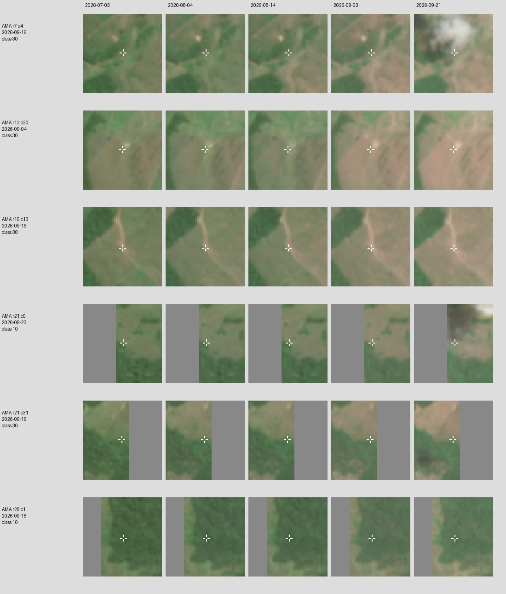

# Проверка кандидатов Амазонии: подтверждённых вырубок нет

Срез источников на 14 ноября 2026 года. Проверены **все шесть HV drop**,
включая пять точек ниже текущего порога карты |z|=2.5. Параметры детектора
не менялись, чтобы получить удобный результат.

**Результат:** три сигнала относятся к уже открытому покрытию, одна точка
похожа на ложное выделение изменения, причины двух сигналов на лесных кромках не установлены.
Ни для одной точки свежая потеря леса совместно RGB и алертами не подтверждена.
Это результат разбора шести кандидатов, не оценка точности всего детектора.

## Источники и правило сопоставления

- NISAR: сохранённые HH/HV на шести датах 18 июля — 28 сентября 2026 года,
  с исходными квитанциями и хешами в `data/amazon.json`.
- RGB: пять сцен Sentinel-2, 3 июля, 4 и 14 августа, 3 и 21 сентября;
  единая шкала яркости. Дополнительно прочитаны окна SCL, чтобы не принять
  облако или тень за изменение. Ясным назван только пиксель SCL 4 или 5
  с валидным RGB. Это проверка маски, а не безошибочная разметка.
- [INPE DETER / TerraBrasilis](https://terrabrasilis.dpi.inpe.br/en/home-page/):
  свежий WFS-запрос для bbox с запасом около 500 м, с 24 июня по 14 ноября.
  Ответ полный, **0 полигонов**. Запрос, ответ и SHA-256 сохранены.
- [UMD GLAD-L](https://glad.umd.edu/dataset/glad-forest-alerts):
  выпуск **13 ноября**, тайл `050W_10S_040W_00N`. Выпуск 14 ноября существует,
  но нужного тайла в нём ещё нет; это явно записано в квитанции.
  В прочитанном окне 78 подтверждённых пикселей (код 3) и 122 неподтверждённых
  (код 2), без отсева маленьких пятен. Старый контекстный GeoJSON не использовался
  как источник подтверждения: у него нет квитанции происхождения.

Прямое совпадение — точка лежит внутри полигона; соседство до **30 м**
записывается отдельно. Для поддерживающего алерта требуется дата в пределах
**±60 дней** от `since`; GLAD — только код 3. Совпадений нет даже с допуском 30 м.
Расстояния рассчитаны в UTM 22S. Дата `since` — разбиение короткого радарного
ряда, не установленная дата физического события.

Отсутствие алерта не доказывает отсутствия изменения. GLAD ориентирован
на потерю древесного покрова, имеет маску леса и задержки; DETER также
имеет ограничения обнаружения. Эти источники не подтверждают сезонное
высыхание поля. По этой выборке нельзя считать precision, recall, площадь
вырубки или опережение алертов.

## Разбор точек

| Точка | Ясные RGB до / после | Наблюдение | Вывод |
|---|---|---|---|
| AMA r7 c4 | 3 / 21 сентября | Открытый участок существует уже в июле; к сентябрю буреет, последний z +0.60 | Изменение открытого покрытия; свежая вырубка не подтверждена |
| AMA r12 c20 | 3 / 21 сентября | Открытое поле светлеет, SCL 4 → 5. Неподтверждённый GLAD в 89 м от точки, подтверждённый — в 165 м | Есть изменение вида поля, но совпадения с алертом в точке нет |
| AMA r15 c13 | 3 / 21 сентября | Участок у дорожки открыт уже в июле; к сентябрю буреет | Изменение травянистого покрытия или влажности — гипотеза, не доказанная причина |
| AMA r21 c0 | 14 августа / 3 сентября | Кромка леса сохраняется. 21 сентября в точке тень, SCL=3; дата исключена из ясной пары | Причина устойчивого снижения HV не установлена; ни подтверждённой вырубкой, ни доказанным шумом не является |
| AMA r21 c31 | 3 / 21 сентября | Точная координата попадает на существующую лесную кромку, хотя WorldCover 2021 даёт код 30; заметного удаления кроны нет | Причина сигнала не установлена; возможен смешанный сигнал кромки |
| AMA r28 c1 | 3 / 21 сентября | Крона сохраняется; после временного провала z возвращается к −0.18 | Вероятное ложное выделение устойчивого изменения |



Лист показывает увеличенные пиксели, а не дополнительное пространственное
разрешение. WorldCover 2021 — исторический класс, а не доказательство покрытия
в 2026 году. Четыре точки с кодом 30 не следует называть вырубками леса.
Возможное сезонное высыхание и влажность — интерпретации, не измеренные причины.

## Чувствительность к короткому ряду

При исключении по одной из шести дат форма HV drop сохраняется:

| Точка | Сохранено / 6 прогонов |
|---|---:|
| AMA r7 c4 | 3 |
| AMA r12 c20 | 4 |
| AMA r15 c13 | 3 |
| AMA r21 c0 | 5 |
| AMA r21 c31 | 5 |
| AMA r28 c1 | 2 |

Это диагностическая чувствительность на тех же данных, не внешняя оценка
точности и не вероятность истинности. Низкая устойчивость r28 c1, возврат
к медиане и сохранение кроны совместно поддерживают версию ложного выделения
изменения. Они не устанавливают природу радарного шума.

## Воспроизведение

```bash
python -m pip install -r scripts/requirements.txt
python scripts/validate_amazon.py --as-of 2026-11-14
python -m pytest scripts/test_validate_amazon.py -q
```

Результат — `data/amazon/validation.json`. Исходные окна GLAD/SCL,
WFS-ответ, URL, хеши и визуальные заметки — `data/amazon/validation/`.
`--refresh` перечитывает источники. Визуальные оценки привязаны к хешам
входов: после их изменения они не переносятся автоматически и требуют просмотра.
На сайте окно сверки перечисляет все шесть кандидатов; кнопка точки открывает
её карточку и соответствующую оптику.

Следующий полезный шаг — исследовать причины сигналов r21 c0 и r21 c31 и проверить детектор
на независимых положительных случаях GLAD, а не подбирать пороги под эти шесть точек.

## Связь с ресурсами задачи

[Официальная вкладка ресурсов Dancing with the SARs](https://www.spaceappschallenge.org/2026/challenges/dancing-with-the-sars/?tab=resources),
которую прислал пользователь, проверена: в ней есть Earthdata Search,
ASF Vertex и NISAR Data User Guide, соответствующие основной цепочке данных проекта.
DETER, GLAD и Sentinel-2 здесь служат дополнительной независимой проверкой NISAR.
