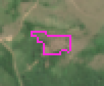
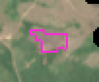
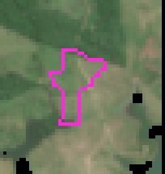
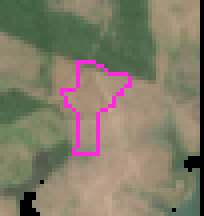
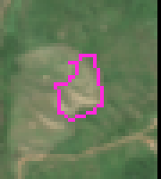
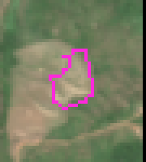

# Региональные датированные disturbance leads — Itupiranga, Pará

## Короткий вывод

Нашёл три конкретных **INPE DETER Amazon** alert-полигона 2026 года в пределах 25 км от центра исходного исследования (`data/amazon.json`: **−4.775, −49.275**). Все три геометрии находятся примерно в 9–23 км от центра, то есть **вне компактных подготовленных NISAR sparse/dense bounds**. Это подходящие внешние leads для переноса исследования, но не NISAR/SAR-обнаружения.

| INPE WFS feature ID | `view_date` (дата наблюдения) | Публикация | До центра | Площадь геометрии | Близкие Sentinel‑2 L2A сцены и медиана NDVI внутри полигона |
|---|---:|---:|---:|---:|---|
| `deter_amz.31637_curr` | 2026‑09‑02 | 2026‑09 | 9.21 км | 6.53 га | 2026‑08‑04 (−29 дн.): 0.585; 2026‑09‑21 (+19 дн.): 0.217 |
| `deter_amz.26062_curr` | 2026‑08‑04 | 2026‑08 | 19.49 км | 8.88 га | 2026‑07‑03 (−32 дн.): 0.720; 2026‑08‑14 (+10 дн.): 0.383 |
| `deter_amz.23558_curr` | 2026‑07‑21 | 2026‑07 | 23.15 км | 7.20 га | 2026‑07‑03 (−18 дн.): 0.585; 2026‑08‑04 (+14 дн.): 0.461 |

Initial within-polygon NDVI changes are now tested against nearby same-scene rings below; they are not used by themselves as proof of fresh clearing.










Розовый контур показывает только геометрию DETER, RGB-подложка — Sentinel‑2 L2A, фиксированное отображение reflectance 0–0.3 с гаммой 2.2. Чёрные области — nodata/невалидные пиксели (в индексах исключены по SCL). Аналогичные небольшие окна для двух других объектов находятся в `data/investigation/regional/`.

**Буквальные наблюдения всех шести RGB окон:** `31637`: до снимка уже видна частично открытая/коричневая мозаика внутри полигона; после область выглядит коричневее/более открытой, но не как однородный свежий срез. `26062`: до полигон в целом зеленее, после коричневее/открытее; RGB не устанавливает onset. `23558`: смешанные тона до и немного коричневее после, но соседний ландшафт тоже заметно коричневеет. Во всех случаях DETER polygon — это граница registry alert, **не независимо подтверждённая граница или дата начала расчистки**.

## Targeted falsification по cached NPZ

Расчёт воспроизводится только из уже сохранённых окон и полигонов; новых network requests не делает. Для каждого пикселя требуется валидный NDVI и NDMI на обеих датах и один и тот же пиксель проходит SCL на обеих датах. Сравниваются полигон и непересекающиеся кольца 60–120 м, 120–240 м от projected DETER geometry. Показана **медиана pixelwise (after−before)**; это устойчивый paired change. Разность медиан отдельно сохранена как `difference_of_medians` в JSON и не смешивается с paired estimate.

| Event | Маска | Полигон: Δ NDVI / Δ NDMI (n) | 60–120 м: Δ NDVI / Δ NDMI (n) | 120–240 м: Δ NDVI / Δ NDMI (n) | Калиброванный вывод |
|---|---|---|---|---|---|
| `31637` | строгая SCL 4/5/6 | −0.284 / −0.217 (162) | −0.095 / −0.091 (260) | −0.104 / −0.100 (682) | **Поддержанное локальное оптическое снижение**, сильнее сезонного/фонового сдвига; до снимка мозаика уже частично открыта. Не «свежая сплошная вырубка». |
| `26062` | строгая SCL 4/5/6 | −0.297 / −0.303 (214) | −0.175 / −0.189 (315) | −0.159 / −0.174 (762) | **Поддержанное дополнительное локальное снижение** сверх значительного общего побурения. Не подтверждает свежую сплошную расчистку. |
| `23558` | строгая SCL 4/5/6 | −0.110 / −0.068 (178) | −0.118 / −0.113 (258) | −0.111 / −0.117 (672) | **Registry-only для локальной интерпретации:** inside change практически совпадает с кольцами, NDMI меняется даже слабее. |

Эти Δ — медианы парных пиксельных изменений. Для двух первых событий difference-of-medians также больше inside: NDVI (полигон против 60–120/120–240 м) составляет `31637 −0.369 vs −0.115/−0.108`, `26062 −0.349 vs −0.214/−0.173`; для `23558` `−0.123 vs −0.119/−0.111`. Это две разные статистики, обе доступны для NDVI/NDMI и обе без p-values.

**Pre-NDVI matched ring subset** выбирался до просмотра after: кольцевые пиксели с pre-NDVI в пределах ±0.1 от медианы pre-NDVI полигона. В `31637` осталось 94 и 294 pixels, медиана paired Δ NDVI в кольцах −0.142/−0.165 против −0.284 inside. В `26062` осталось 76/295 (строгая маска), ring Δ −0.206/−0.206 против −0.297 внутри; расширенная маска даёт n=84/306 и −0.223/−0.209 против −0.292. В `23558` осталось 54/141, но matched ring Δ −0.171/−0.191 — больше по модулю, чем −0.110 внутри. Во всех subsets n≥20; это подбор только по начальной NDVI, не отбор по after и не verified negatives.

**SCL ablation:** кроме `26062`, где 9 polygon pixels в before имеют класс 7 (unclassified), строгая `[4,5,6]` и расширенная `[4,5,6,7]` маски дают те же polygon supports/оценки. Для `26062` расширение увеличивает paired polygon n с 214 до 223 и медианный Δ NDVI меняется лишь с −0.297 до −0.292 (NDMI −0.303 до −0.299). В полигоне SCL counts `before → after`: `31637` class 4/5: `152/10 → 37/125`; `26062` class 4/7: `214/9 → 91/0`, class 5 после: 132; `23558` class 4/5: `169/9 → 135/43`. Полные histograms — для crop, полигона и колец, в JSON. Маска учитывает только классы, но class transitions сами по себе не доказывают расчистку.

Кольца — **nearby comparison, не verified negative controls**: они могут содержать другие воздействия или быть частью той же сезонности. Сходное падение в кольцах у `23558` понижает optical support до registry-only. Соседние пиксели автокоррелированы, поэтому n — покрытие, не независимые повторы; p-values и blind detector accuracy не заявляются. Сходимость inside-vs-ring для двух leads поддерживает только локализованное уменьшение оптического vegetation/wetness signal относительно ближайшего фона, не полную вырубку, причинность или точный event onset.

## Provenance audit и исправление calibration receipt

- Initial WFS body и raw STAC Item bodies из первого прохода **не сохранялись**. Поэтому выполнен один bounded повтор того же WFS URL и GET тех же STAC Item URLs с обычной TLS certificate verification. Текущий WFS body сохранён как `data/investigation/regional-raw/wfs-refetched-response.json`, четыре уникальных Item bodies — `stac-item-<scene-id>.json`; время повторного получения, HTTP status, URL, пустое GET body, byte count и SHA-256 записаны в `manifest.json`. Никакой raw payload не реконструировался из derived GeoJSON.
- WFS refetch: 20 source features. У выбранных трёх ID все исходные properties и coordinates совпали с derived selected GeoJSON (`exact_geometry_and_source_properties_match`). Сравнить полный текущий ответ с первоначальным WFS response/version невозможно: первоначальный body не был сохранён; это явно отмечено в receipt.
- Архивированы четыре уникальных raw STAC Item response, соотносимых со всеми шестью event/phase uses. У каждого источника `earthsearch:boa_offset_applied` — JSON boolean `true` (тип `bool`), baseline `05.12`/`05.13`. Исходная metadata каждого band указывает scale `0.0001`, offset `−0.1`; поскольку BOA offset уже применён, **effective calibration — scale `0.0001`, offset `0`**, branch `boa_offset_applied_true_effective_offset_zero`.
- В прежнем receipt было записано `−0.1`, но исходный расчёт уже проверял BOA flag. Для полностью воспроизводимого пересчёта сохранены также raw digital values только из шести ранее использованных окон тех же COG scenes (никаких новых дат или whole-scene downloads). Все четыре summary metric на каждой из шести сцен повторно совпали с прежними числами; поэтому парные контрасты и статусы не изменились. Для первого исходного NPZ hash повторного расчёта совпал с прежде записанным hash побайтно. Старые contrast JSON сохранены в `targeted_falsification_before_provenance_fix` для audit; текущий `targeted_falsification` построен из повторно вычисленных cached NPZ.
- `manifest.json` содержит hash исходных STAC/WFS тел, все шесть source uses, raw band window receipts и SHA-256. `data/investigation/regional-events.json` сохраняет исходные поля и добавляет verified source/effective calibration, old-vs-current comparison и pixel-window references.

## Источник, даты, лицензия и охват

- **Реестр:** INPE TerraBrasilis / DETER Amazon; WFS `deter-amz:deter_amz`, опубликованный через [GeoServices](https://terrabrasilis.dpi.inpe.br/en/layers-via-geoservices/). Прямая bounded WFS-запись, фильтр дат 2025‑01‑01—2026‑12‑31 и пространственный прямоугольник, ограничивающий радиус 25 км, вернула 20 записей; 12 геометрий пересекают сам 25‑км круг. Небольшой сырой ответ — 17,693 байта. Применено точное расстояние от центра до геометрии в UTM 22S, чтобы отсечь углы прямоугольника.
- **Идентификатор:** WFS feature ID, а также `gid`, сохранены; три геометрии доступны в `data/investigation/regional/deter-selected.geojson`. Содержимое этой GeoJSON сверено с официальной WFS-выгрузкой; SHA-256 указан в JSON receipt.
- **Значение даты:** WFS `view_date` — дата наблюдения исходного изображения, связанная с alert, **не гарантированная дата начала воздействия**. `publish_month` — месяц публикации; сервис не предоставил отдельную точную processing timestamp для этого слоя. Нельзя выводить onset как точный день события.
- **Класс:** `DESMATAMENTO_CR`; TerraBrasilis описывает DETER как оперативные alert-данные и помечает слои как экспериментальные/подверженные последующим изменениям. Это external registry support, не независимая blind-оценка точности DETER.
- **Лицензия:** портал TerraBrasilis публикует [CC BY‑SA 4.0](https://creativecommons.org/licenses/by-sa/4.0/); при повторном распространении сохранять атрибуцию INPE/TerraBrasilis и ShareAlike. Sentinel‑2 — Copernicus Sentinel data, распространяемые по условиям Copernicus; Earth Search — каталог/доступ к COG, не владелец снимков.
- **S2:** Earth Search STAC (`sentinel-2-l2a`), точные item IDs, UTC acquisition `datetime` (наблюдение), `created`/`updated` (время записи каталога, **не processing timestamp сенсора/процессора**), query bbox, COG asset hrefs, calibration, SCL policy, transformed bounds, result hashes и byte counts сохранены в `data/investigation/regional-events.json`. Читаются только маленькие COG окна вокруг события, не целые сцены. Зафиксированы и сцены, которые вернул каталог; PNG/NPZ previews — производные материалы, не исходные данные.

## Пространственная оговорка и уверенность

Региональные DETER геометрии не пересекаются с исходным Amazon bbox примерно 2.5 × 2.5 км (и удалены от центра на 9.2, 19.5 и 23.2 км). Подготовленные NISAR subsets имеют компактные bounds около исходного AOI. Поэтому это **региональные leads для переноса исследования**, не SAR candidates/результаты. Уверенность для `31637`/`26062` — умеренная в локализованном оптическом снижении покровного сигнала относительно колец, низкая в полной расчистке/причине/точном onset; для `23558` — registry support без локального оптического подтверждения относительно фона.

Ни годовые слои Hansen/PRODES, ни старые локальные alert GeoJSON не использовались как свидетельства новых событий. Не утверждается полнота обнаружения событий в радиусе: bounded WFS показывает записи, доступные на дату запроса; ограничения сервиса/обновлений могут менять результат.

## Повторение

```bash
/tmp/opencode/nasa-venv/bin/python scripts/investigate_regional_events.py
/tmp/opencode/nasa-venv/bin/python scripts/archive_regional_provenance.py
/tmp/opencode/nasa-venv/bin/python scripts/reconcile_regional_provenance.py
/tmp/opencode/nasa-venv/bin/python scripts/cache_regional_raw_optical.py
/tmp/opencode/nasa-venv/bin/python scripts/recompute_regional_indices_offline.py
/tmp/opencode/nasa-venv/bin/python scripts/analyze_regional_falsification.py
/tmp/opencode/nasa-venv/bin/python scripts/export_regional_overlays.py
python scripts/build_investigation_page.py
```

Архиватор повторяет bounded WFS/STAC requests с TLS verification; reconcile — локальный; raw-band cache читает только маленькие прежние COG окна; анализ — cached-only. Offline проверки:

```bash
/tmp/opencode/nasa-venv/bin/python scripts/test_investigate_regional_events.py
```
