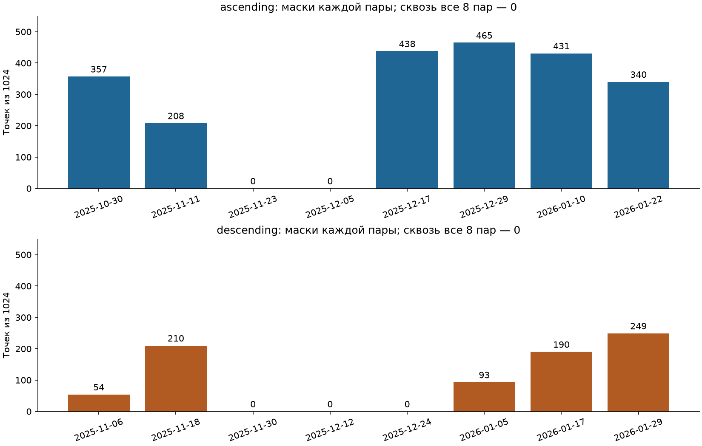
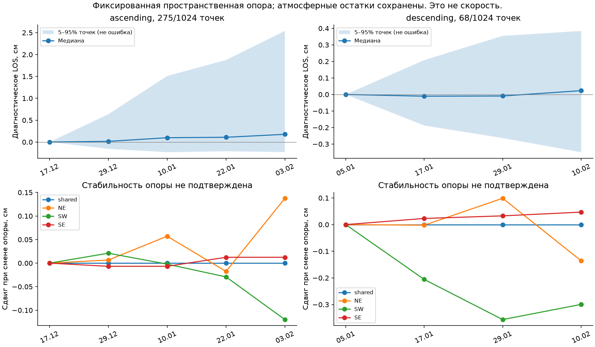
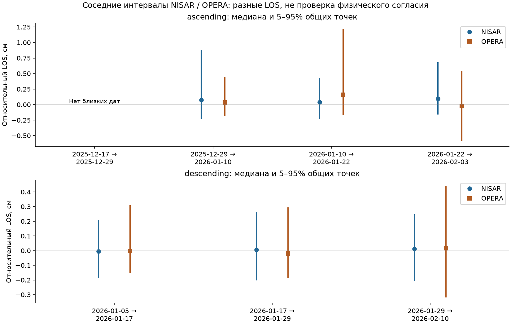

# Мехико: доступность временного ряда смещений (#16, #36)

Это исходный срез первых 16 пар. Результат последующей догрузки всех 54 гранул
приведён [в полном расчёте](mexico-long-series.md); ограничения ниже относятся
к исходному срезу, а не к состоянию после догрузки.

**Вывод:** сохранённых измерений достаточно для коротких диагностических рядов
относительного LOS, но недостаточно для подтверждённой скорости и разложения на
вертикаль/восток. Стабильная опорная область не установлена. OPERA даёт независимые
измерения, однако физическое согласие с NISAR по этим выборкам подтвердить нельзя.

## Покрытие и маски

| Показатель | 019A/011 | 113D/079 |
|---|---:|---:|
| Гранулы в сохранённом свежем запросе PROVISIONAL V1 | 28 | 26 |
| Прочитанные пары, с исходными слоями качества и SHA-256 | 8 | 8 |
| Каталожные гранулы без локальной выборки | 20 | 18 |
| Точки, прошедшие все восемь пар | 0 | 0 |
| Выбранный отрезок | 2025-12-17 → 2026-02-03 | 2026-01-05 → 2026-02-10 |
| Последовательных пар / дней | 4 / 48 | 3 / 36 |
| Точек в одной комбинации компонент во всех выбранных парах | 275/1024 (26,86%) | 68/1024 (6,64%) |
| При пороге coherence 0,6 / 0,7 / 0,8 | 480 / 275 / 90 | 220 / 68 / 9 |

Общих координат **39/1024 (3,81%)**; временное пересечение
**29 дней**, 2026-01-05 → 2026-02-03.
Точных общих эпох: **0**. Число точек — число
разреженных мест выборки, не число независимых наблюдений и не площадь.



Сохранены результаты для **всех 42 последовательных окон от трёх пар** (21 на
направление), включая пустые. Выбранные отрезки соответствуют прежнему
`mexico-gunw-postgap-quality.json`, а не максимуму смещения. Анализ чувствительности
порога не меняет основной порог 0,7 и не означает принятие более слабой маски.
Каталог ограничен PROVISIONAL V1: непрочитанные и VALIDATED продукты не признаны
непригодными. Отсутствие длинного ряда установлено для сохранённых выборок.

Маска требует конечных phase/ionosphere, coherence в [0,7; 1], component в
1…65534, невода и валидных подсвотов в младшем байте, отсутствия anomaly bits
8…23 и 25…31, ionosphere uncertainty в [0; 1] рад. Бит 24 интерполированной
ионосферы допускается и подсчитан отдельно. Каскад исключений по каждой паре
сохранён в JSON. Компонентные метки независимы между парами: используется
одна наиболее многочисленная **комбинация** меток, а не равенство номера между датами.

## Опора и диагностическое смещение

Из 39 общих координат **38** также имеют конечное OPERA
на всех датах. Эти фиксированные координаты используются для медианной опоры
каждой пары. Контрольные квадранты AOI: NW 0, NE 3, SW 5, SE 30 точек;
NW не используется. Отбор по величине смещения не выполнялся. Это технические
области для проверки чувствительности, а не доказанно стабильный грунт.

Вычитается ионосферная фаза, затем пространственная медиана опоры. Преобразование:
`LOS_cm = -(phase-ionosphere) × 299792458/(4πf) × 100`; положительное направление
— к спутнику, по прежней конвенции проекта. Тропосфера и приливы не удалены.
Данные новых квитанций не содержат подтверждения flattening; поэтому эти цепочки
помечены диагностическими. Знак не подгоняется под ожидаемое проседание.
Нулевая эпоха — соглашение; наблюдения через пробелы не соединяются.



Диапазон сдвига конечного результата при выборе трёх допустимых квадрантов и
общей опоры: **0.257 см ascending** и
**0.346 см descending**. Это не доверительный
интервал: общий дрейф всей AOI и пространственно коррелированная атмосфера могут
сохраниться при любой из этих опор. Малый относительный разброс не подтверждает
неподвижность. Полосы 5–95% на графике показывают пространственный разброс точек,
не точность оценки.

Станция MMX1 расположена в 20.56 м от ближайшей точки, но она
проходит только **2/4 ascending и 0/3 descending** масок. Использовать эту точку
для привязки цепочки нельзя. Сам GNSS также не является неподвижной опорой.
Отдельно показанная ранее GNSS-привязка OPERA остаётся модельной оценкой с
допущениями, а не независимой проверкой NISAR.

## Независимый OPERA DISP-S1

Проверены координатный fingerprint, общий frame F01088, опорная дата
2025-12-25, строгий порядок **15 наблюдений** за
2025-12-31 → 2026-03-25, размерность, конечность и
число принятых значений **1018–1021/1024**; на всех датах доступны
**1018** координат. Искусственный ноль на
опорную дату не добавлен. Речь идёт о сохранённых после `recommended_mask=1`
значениях: исходные recommended mask, connected components и геометрия OPERA
не сохранены, поэтому удалённые маски здесь повторно не проверялись.

Сверка использует **нефильтрованный `displacement`**, а не локально
фильтрованный `short_wavelength_displacement` из прежнего UI. У всех продуктов
сохранены ID/CMR ID/URL. К каждой NISAR-дате выбрана ближайшая реальная OPERA-дата
с допуском не более трёх суток, без интерполяции и экстраполяции. Начало первой
ascending пары отстоит на 14 дней и отклоняется; остальные ascending интервалы
сдвинуты на +2 дня, descending на +1 день.

| Направление | NISAR интервал | OPERA интервал | Общих точек | Медиана NISAR, см | Медиана OPERA, см |
|---|---|---|---:|---:|---:|
| ascending | 2025-12-29 → 2026-01-10 | 2025-12-31 → 2026-01-12 | 273 | 0.075 | 0.036 |
| ascending | 2026-01-10 → 2026-01-22 | 2026-01-12 → 2026-01-24 | 273 | 0.040 | 0.159 |
| ascending | 2026-01-22 → 2026-02-03 | 2026-01-24 → 2026-02-05 | 273 | 0.094 | -0.028 |
| descending | 2026-01-05 → 2026-01-17 | 2026-01-06 → 2026-01-18 | 67 | -0.004 | -0.003 |
| descending | 2026-01-17 → 2026-01-29 | 2026-01-18 → 2026-01-30 | 67 | 0.006 | -0.020 |
| descending | 2026-01-29 → 2026-02-10 | 2026-01-30 → 2026-02-11 | 67 | 0.011 | 0.016 |



Это **описательное сопоставление двух разных LOS**, после одинаковой
пространственной привязки. Медианы около нуля отчасти заданы самой опорой.
Без проекции в общую геометрию, контроля компонент и атмосферных поправок
численное сходство не является валидацией; RMSE согласия и «точность» не заявляются.
Исходная рекомендация OPERA выбирать высококачественные пиксели не доказывает
геологическую стабильность продуктовой опоры.

## Что показывать в интерфейсе

Состояние в JSON: `insufficient_for_velocity`, `velocity_available=false`,
`vertical_east_available=false`. Показывать исходную одиночную пару в сантиметрах
с её собственными датами; рядом — ограничения ряда и ссылку на этот расчёт.
Диагностические цепочки доступны в отчёте. Не выдавать 48/36-дневное относительное
смещение за годовую скорость. Слои NISAR `up`/`east` не создаются.

Для скорости нужны более длинные связанные выборки, документированная
стабильная или измеренная внешняя опора, подтверждение обработки фазы, поправки
атмосферы и оценка временной ковариации ошибок. Для разложения дополнительно
нужны LOS ENU векторы обоих направлений, согласованные интервалы и обоснование
допущения северного движения. В сохранённых парах LOS векторов **0/7**.

## Воспроизведение и источники

```sh
.venv/bin/python -m pip install -r scripts/requirements.txt
.venv/bin/python -m scripts.mexico_displacement
.venv/bin/python -m pytest scripts/test_mexico_displacement.py -q
# Необязательно: обновить только публичный каталог (изменит его дату и SHA-256)
.venv/bin/python -m scripts.mexico_displacement --refresh-catalogue
```

Расчёт офлайн заново проверяет SHA-256 всех NPZ и координаты относительно
`data/mexico.json`, читает исходные quality layers, пересчитывает маски и цепочки,
записывает JSON и три PNG. Изменение входов меняет `input_sha256`; несовпадение
NPZ с исходной квитанцией останавливает расчёт. Скрипт не изменяет исходные
измерения. Для повторной выгрузки оригиналов нужны Earthdata Login и скрипты
`inspect_mexico_gunw_series.py` / `inspect_opera_disp.py`. Доступа Earthdata в
этом запуске не использовалось; новые измерения из непрочитанных гранул не заявлены.

- [Числа, цепочки, маски, все источники гранул и входные SHA-256](../data/analysis/mexico-displacement-audit.json).
- [Свежий запрос CMR, дата проверки и 54 гранулы](../data/evidence/mexico-gunw-catalogue.json).
- [Исходные GUNW NPZ и квитанции](../data/subsets/mexico-gunw-series/).
- [Исходная выборка OPERA](../data/mexico/opera-disp.json).
- [NASA/ASF: GUNW, единицы и неприменённые поправки](https://nisar-docs.asf.alaska.edu/gunw/).
- [NASA/JPL: спецификации OPERA DISP-S1](https://www.jpl.nasa.gov/go/opera/products/disp-product-suite/).
- [ASF: использование OPERA и маски](https://docs.asf.alaska.edu/datasets/disp_usage/).
- [ISCE3 Crossmul: конвенция фазы](https://github.com/isce-framework/isce3/blob/develop/cxx/isce3/signal/Crossmul.cpp).
