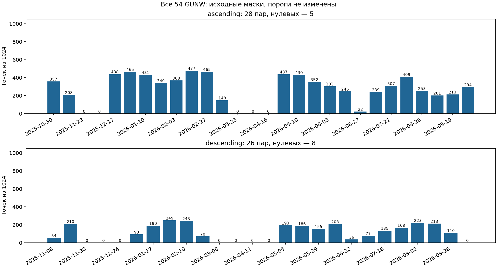
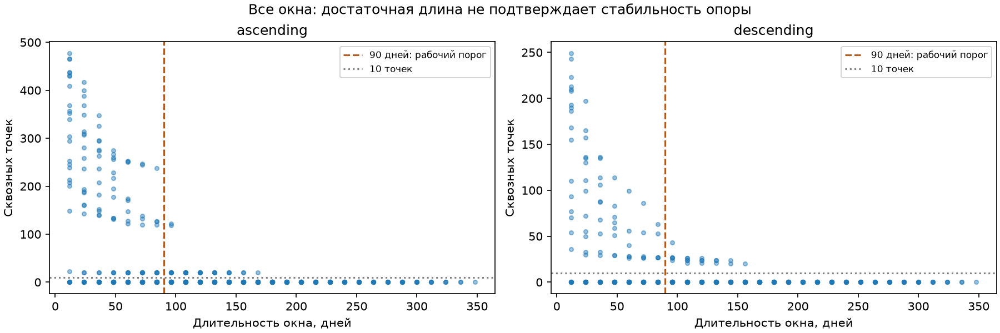
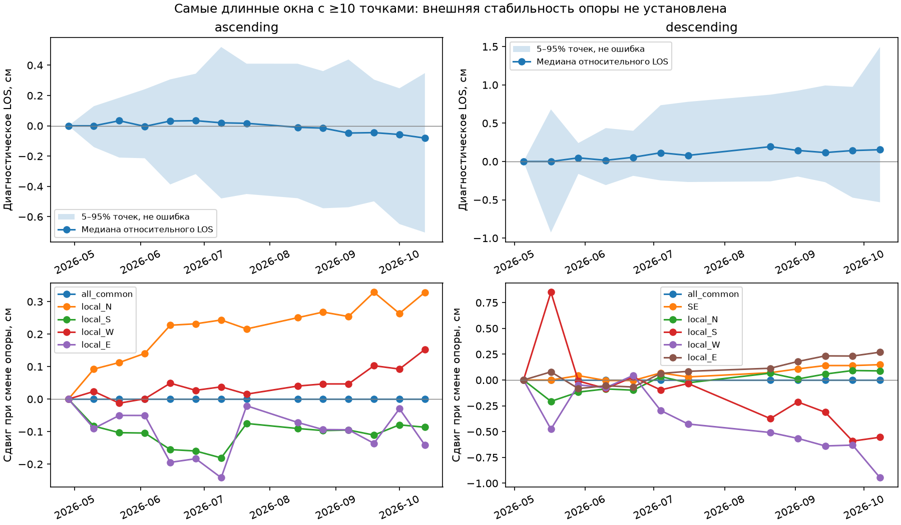

# Мехико: полная догрузка GUNW и проверка длинного ряда

Догружены native окна **38/38** оставшихся гранул Earthdata; вместе с прежними
16 проверены **все 54** гранулы сохранённого каталога PROVISIONAL V1. Полные HDF5
не копируются: сохраняются исходные окна AOI, метаданные и контрольные суммы.

| Направление | Пар | Нулевых пар | Точек сквозь все пары | Самое длинное окно с ≥10 точками, дней | Точек в нём |
|---|---:|---:|---:|---:|---:|
| ascending | 28 | 5 | 0 | 168 | 20 |
| descending | 26 | 8 | 0 | 156 | 20 |

Чувствительность результата к минимальному числу сквозных точек:

| Минимум точек | Длиннейшее ascending окно, дней | Длиннейшее descending окно, дней |
|---:|---:|---:|
| 1 | 168 | 156 |
| 3 | 168 | 156 |
| 10 | 168 | 156 |
| 30 | 96 | 96 |
| 100 | 96 | 48 |





Окна перебраны полностью, без отбора по направлению или величине смещения.
Проверены SHA-256, координаты, даты, направление, frame/track и одинаковая маска.
Номера компонент между парами независимы: проверяется их совместная комбинация.
Порог coherence 0,7 и uncertainty ≤1 рад сохранён. Разрывы и отклонённые точки
не заполняются. Начальный условный ноль не считается наблюдением регрессии.

Для каждого направления JSON содержит самые длинные окна с минимум 1/3/10/30/100
сквозными точками, диагностику фиксированных квадрантных опор и атмосферных
ограничений. Рабочие пороги длинного окна — 90 дней и 8 пар — не являются
доказательством точности или стабильности. Кандидат с ≥10 точками выбирается
по длине, затем по числу точек; это исследовательский, ретроспективный отбор.
Для исследовательской регрессии дополнительно требуются минимум 90 дней между
реальными вторичными эпохами; условный начальный ноль этот интервал не увеличивает.

**Опора:** неподвижных внешних контрольных точек в этом расчёте не установлено.
Сходство фаз, высокая когерентность и малое расхождение квадрантов не исключают
совместное проседание всей AOI или атмосферный остаток. Поиск выполнен в прежней
AOI 0,025° × 0,025°; утверждение об отсутствии стабильного грунта во всём Мехико
не делается. GNSS MMX1 не объявляется неподвижной опорой.
Сравниваются только разные наборы опорных координат. Дополнительно к квадрантам
AOI используются северная/южная и западная/восточная половины bbox сквозных
точек; минимум три точки на опору. Границы зависят от координат и маски,
не от величины смещения. Тождественные наборы удалены из сравнения.

- ascending: 2026-04-28 → 2026-10-13, 13 пар, 20 точек. Смена квадрантной опоры сдвигает конечное относительное смещение на 0.470 см; это не доверительный интервал.
  Исследовательский наклон LOS: медиана -0.195 см/год, пространственные 5–95% -1.743…0.509; реальных вторичных эпох — 13, продолжительность — 156 дн. Внешняя стабильность и систематическая ошибка не установлены; это не подтверждённая скорость.
  Диапазон сдвига наклона при смене опоры: 0.457 см/год. Также сохранена чувствительность к исключению одной эпохи; ни один из этих диапазонов не является доверительным интервалом.
- descending: 2026-05-05 → 2026-10-08, 11 пар, 20 точек. Смена квадрантной опоры сдвигает конечное относительное смещение на 1.216 см; это не доверительный интервал.
  Исследовательский наклон LOS: медиана 0.938 см/год, пространственные 5–95% -1.305…3.073; реальных вторичных эпох — 11, продолжительность — 144 дн. Внешняя стабильность и систематическая ошибка не установлены; это не подтверждённая скорость.
  Диапазон сдвига наклона при смене опоры: 3.090 см/год. Также сохранена чувствительность к исключению одной эпохи; ни один из этих диапазонов не является доверительным интервалом.



Внешний контроль MMX1: суточных решений — **322**, интервал —
2025-10-30 → 2026-10-20; изменение up между первой и последней датами
**-25.93 см**, линейный наклон up
**-26.83 см/год**. Это движение антенны
GNSS в IGS20, не скорость NISAR и не неподвижная опора. Ближайшая радарная
точка проходит 3/28 ascending и
0/26 descending масок.

Если окно позволяет линейную регрессию, её относительный наклон и ограничения
отдельно записаны в `relative_rate_fit`. Это не подтверждённая скорость грунта.
Для новых гранул сохранены фактические flattening flags и исходные LOS ENU кубы
на всех высотах. Кубы не подменены произвольной высотой местности. Ионосфера
вычитается; тропосфера и приливы не исправлены, систематическая ошибка неизвестна.

**OPERA:** проверены ближайшие реальные даты для обоих концов самых длинных окон
с допуском три дня. Сохранённые 15 OPERA дат покрывают 2025-12-31 —
2026-03-25; экстраполяция не используется. Физическое согласие
скоростей не заявляется без согласованной опоры, геометрии и обработки атмосферы.
Сравнение прежних коротких интервалов сохранено [в первом расчёте](mexico-displacement.md).

Полный свежий каталог OPERA проверен по всем 1601
динамическим гранулам над AOI, из них 419 относятся
к F01088. Последняя secondary date этого кадра — **2026-03-25**.
Это ограничение каталога, а не ограничение прежней выборки из 15 наблюдений.
Для остальных трёх кадров над AOI также проверены все каталожные записи:
их последние secondary dates не позднее 25 марта 2026 года. Таким образом,
смена кадра в проверенной коллекции OPERA V1 не даёт покрытия летне-осенних окон.

- ascending: NISAR 2026-04-28 → 2026-10-13; ближайшие OPERA 2026-03-25 → 2026-03-25; смещения дат [-34, -202] суток. Оба конца в пределах трёх суток: нет.
- descending: NISAR 2026-05-05 → 2026-10-08; ближайшие OPERA 2026-03-25 → 2026-03-25; смещения дат [-41, -197] суток. Оба конца в пределах трёх суток: нет.

**Для интерфейса:** `insufficient_for_validated_velocity`. Новые слои `up`/`east` не создаются.
Маска и доступность длинных рядов проверены численно; подтверждённая скорость
и вертикальное разложение не получены. Это ограничение результата, а не отсутствие
движения грунта.

**Разложение:** у двух самых длинных выбранных окон
**0** общих координат.
Дополнительно проверены все **190**
комбинаций связанных окон от 8 пар с временным пересечением минимум 90 дней:
максимум общих точек — **0**.
Внешняя общая опора не подтверждена. Различающиеся даты сами по себе не запрещают
оценивать линейные скорости, но требуют обоснованной общей модели движения;
отсутствующие координаты или опору она не восстанавливает.

## Воспроизведение

```sh
.venv/bin/python -m scripts.download_mexico_remaining --inventory
# Только локальная Earthdata-авторизация; токен исключён из Git
.venv/bin/python -m scripts.download_mexico_remaining --workers 4
.venv/bin/python -m scripts.mexico_long_series
.venv/bin/python -m pytest scripts/test_mexico_long_series.py -q
# Обновить публичные независимые источники перед повторным расчётом:
.venv/bin/python -m scripts.mexico_long_series --refresh-gnss --refresh-opera-catalogue
```

Повторная загрузка проверяет кэш по ID и SHA-256 и возобновляется с недостающих
окон. Старые выборки не перезаписаны. Без всех гранул полный аудит останавливается.

- [Все числа, окна, источники гранул и входные SHA-256](../data/analysis/mexico-long-series.json).
- [Квитанция загрузки](../data/analysis/mexico-gunw-download.json).
- [Каталог с исходным запросом CMR](../data/evidence/mexico-gunw-catalogue.json).
- [Полный каталог OPERA с запросом и датой проверки](../data/evidence/mexico-opera-full-catalogue.json).
- [GNSS MMX1: решения, источник и контрольная сумма](../data/analysis/mexico-mmx1-long-gnss.json).
- [Дополнительные исходные выборки](../data/subsets/mexico-gunw-remaining/).
- [NASA/ASF: GUNW и неприменённые атмосферные поправки](https://nisar-docs.asf.alaska.edu/gunw/).
